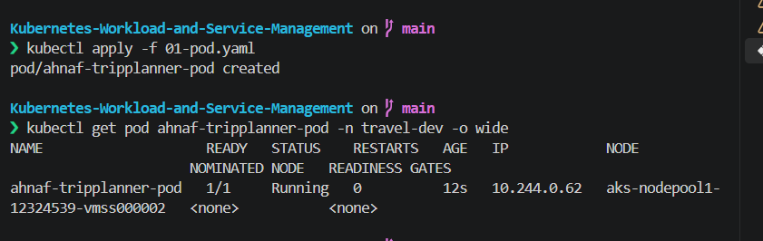
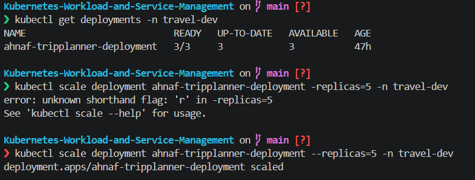
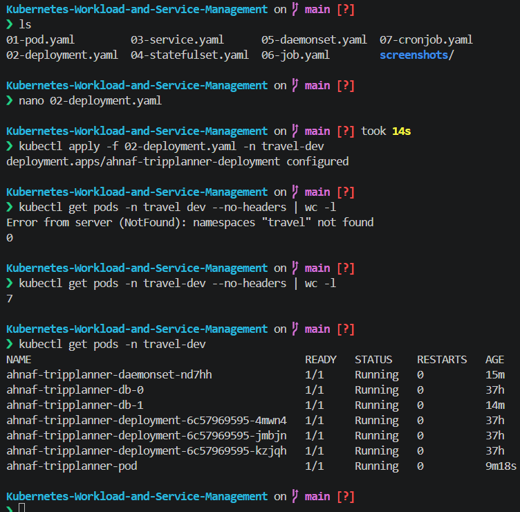
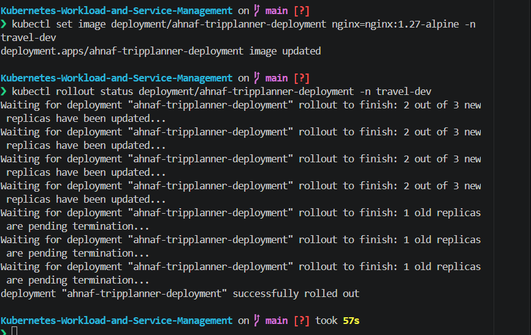
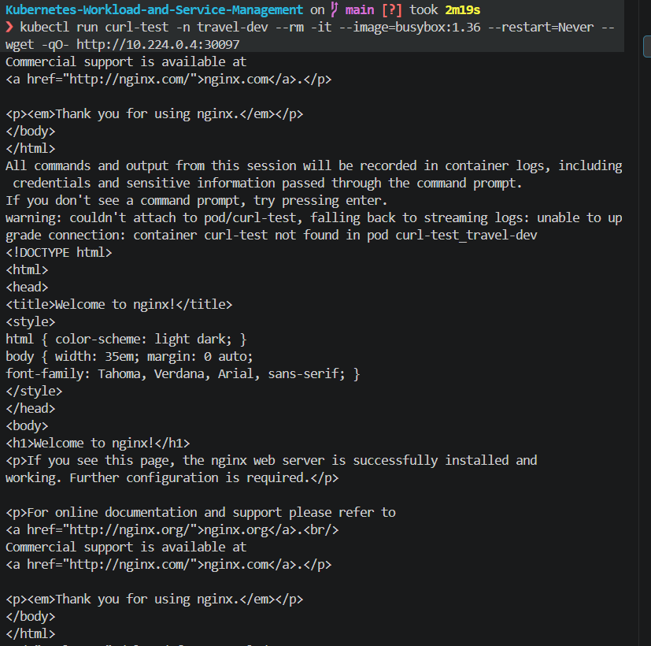
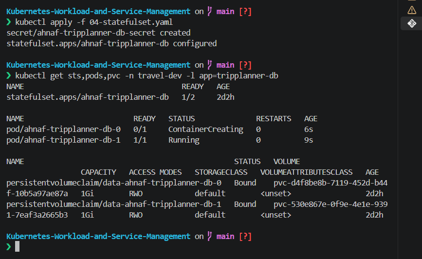
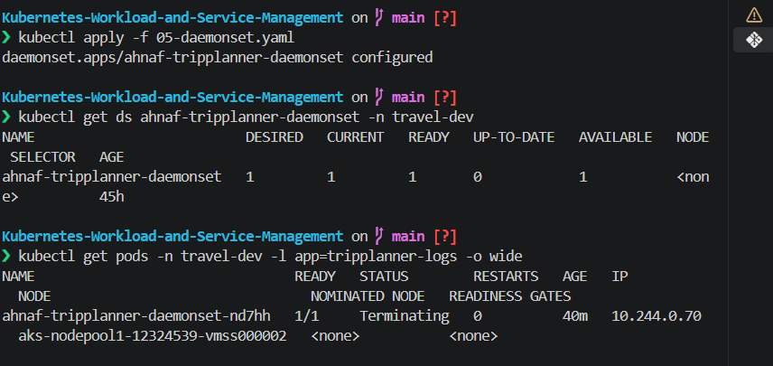

# Kubernetes Workload and Service Management — TripPlanner

Individual practical assignment: seven Kubernetes resources, each in its own manifest, deployed to a namespace of my own on an Azure Kubernetes Service (AKS) cluster.

| Item | Value |
|---|---|
| **Student** | 17 — Ahnaf |
| **Scenario** | Travel Booking |
| **Application name** | `tripplanner` |
| **Namespace** | `travel-dev` |
| **Deployment replicas** | 3 |
| **Container port** | 8017 |
| **NodePort** | 30097 |
| **Naming convention** | every resource starts with `ahnaf-tripplanner-` |
| **Cluster** | AKS (`aks-practice-cluster`, 1 node) |

---

## Table of Contents

1. [Project Structure](#project-structure)
2. [Architecture](#architecture)
3. [Implementation Status](#implementation-status)
4. [Q1 — Pod](#q1--pod)
5. [Q2 — Deployment](#q2--deployment)
6. [Q3 — Services](#q3--services)
7. [Q4 — StatefulSet](#q4--statefulset)
8. [Q5 — DaemonSet](#q5--daemonset)
9. [Q6 — Job](#q6--job)
10. [Q7 — CronJob](#q7--cronjob)
11. [How to Run](#how-to-run)
12. [Notes](#notes)

---

## Project Structure

```
.
├── 01-pod.yaml          # Standalone Nginx Pod
├── 02-deployment.yaml   # Nginx Deployment, 3 replicas
├── 03-service.yaml      # NodePort Service + Headless Service
├── 04-statefulset.yaml  # PostgreSQL StatefulSet + Secret
├── 05-daemonset.yaml    # Node log-collector DaemonSet
├── 06-job.yaml          # One-time DB cleanup Job
├── 07-cronjob.yaml      # DB maintenance CronJob, every 5 minutes
└── screenshots/         # Execution evidence
```

## Architecture

```
Client ──► NodePort 30097 ─► Service :80 ─► Pods :8017   (Deployment x3 + standalone Pod, app=tripplanner)

Headless Service (db-service) ─► StatefulSet db-0, db-1 ─► one 1Gi PVC each   (app=tripplanner-db)

DaemonSet ─► one log-collector Pod per node                                   (app=tripplanner-logs)

CronJob ─► Job ─► Pod   (every 5 minutes)                                     (+ one-off Job)
```

The labels are deliberately different (`tripplanner`, `tripplanner-db`, `tripplanner-logs`), so each controller and each Service selects only its own Pods.

Nginx is configured to listen on the assigned port: the container start command runs `sed` on `/etc/nginx/conf.d/default.conf` to change `listen 80;` to `listen 8017;`, then starts Nginx in the foreground.

## Implementation Status

| # | Resource | Manifest | Name | Manifest complete | Demonstrated on cluster |
|---|---|---|---|:---:|:---:|
| 1 | Pod | `01-pod.yaml` | `ahnaf-tripplanner-pod` | ✅ | ✅ |
| 2 | Deployment | `02-deployment.yaml` | `ahnaf-tripplanner-deployment` | ✅ | ✅ scaling, ✅ rolling update |
| 3 | Services | `03-service.yaml` | `ahnaf-tripplanner-service`, `ahnaf-tripplanner-db-service` | ✅ | ✅ |
| 4 | StatefulSet | `04-statefulset.yaml` | `ahnaf-tripplanner-db` | ✅ | ✅ PVCs bound, ⏳ delete/persistence screenshots |
| 5 | DaemonSet | `05-daemonset.yaml` | `ahnaf-tripplanner-daemonset` | ✅ | ✅ applied, ⏳ new-node demo |
| 6 | Job | `06-job.yaml` | `ahnaf-tripplanner-job` | ✅ | ⏳ screenshots pending |
| 7 | CronJob | `07-cronjob.yaml` | `ahnaf-tripplanner-cronjob` | ✅ | ⏳ screenshots pending |

✅ done · ⏳ still to be captured

---

## Q1 — Pod

**File:** `01-pod.yaml` · **Image:** `nginx:1.27` · **Port:** 8017

A single unmanaged Nginx Pod with the `app` and `environment` labels and CPU/memory requests and limits. It reaches `Running` (1/1).

```bash
kubectl apply -f 01-pod.yaml
kubectl get pod ahnaf-tripplanner-pod -n travel-dev -o wide
```



---

## Q2 — Deployment

**File:** `02-deployment.yaml` · **Replicas:** 3 · **Image:** `nginx:1.27` · **Port:** 8017

Three identical Nginx replicas behind the selector `app: tripplanner`, with resource requests and limits.

### Scaling

Scaled the Deployment up to 5 replicas with `kubectl scale`. (The first attempt used `-replicas`, which is rejected; the correct flag is `--replicas`.)

```bash
kubectl get deployments -n travel-dev
kubectl scale deployment ahnaf-tripplanner-deployment --replicas=5 -n travel-dev
```



### Deployment applied and Pods running

```bash
kubectl apply -f 02-deployment.yaml -n travel-dev
kubectl get pods -n travel-dev
```



### Rolling update

Updated the image to `nginx:1.27-alpine` and watched the rollout replace the Pods gradually until it reported `successfully rolled out`.

```bash
kubectl set image deployment/ahnaf-tripplanner-deployment nginx=nginx:1.27-alpine -n travel-dev
kubectl rollout status deployment/ahnaf-tripplanner-deployment -n travel-dev
```



---

## Q3 — Services

**File:** `03-service.yaml` (two documents)

| Service | Type | Selector | Ports |
|---|---|---|---|
| `ahnaf-tripplanner-service` | NodePort | `app: tripplanner` | `80` → `8017`, nodePort **30097** |
| `ahnaf-tripplanner-db-service` | Headless (`clusterIP: None`) | `app: tripplanner-db` | `5432` |

Both Services are in `travel-dev`. The NodePort Service has 4 endpoints on `:8017`: the 3 Deployment Pods plus the standalone Pod, which carries the same label.

### Accessibility through the Service

AKS nodes have private IPs, so the NodePort was tested from inside the cluster, against the node's internal IP (`10.224.0.4:30097`). The Nginx welcome page is returned.

```bash
kubectl run curl-test -n travel-dev --rm -it --image=busybox:1.36 --restart=Never -- wget -qO- http://10.224.0.4:30097
```



---

## Q4 — StatefulSet

**File:** `04-statefulset.yaml` · **Image:** `postgres:16` · **Replicas:** 2

- `serviceName: ahnaf-tripplanner-db-service` (the headless Service)
- `volumeClaimTemplates`: each replica gets its own 1Gi `ReadWriteOnce` PVC
- Predictable Pod names: `ahnaf-tripplanner-db-0`, `ahnaf-tripplanner-db-1`
- **Credentials come from a Kubernetes Secret**, `ahnaf-tripplanner-db-secret`, which is defined at the top of the same file and referenced through `secretKeyRef`

```bash
kubectl apply -f 04-statefulset.yaml
kubectl get sts,pods,pvc -n travel-dev -l app=tripplanner-db
```

Both PVCs, `data-ahnaf-tripplanner-db-0` and `data-ahnaf-tripplanner-db-1`, are `Bound`.



### Identity and persistence checks

```bash
kubectl exec -n travel-dev ahnaf-tripplanner-db-0 -- psql -U postgress -d postgress -c "CREATE TABLE trips(id int, city text); INSERT INTO trips VALUES (1,'Cox''s Bazar');"
kubectl delete pod ahnaf-tripplanner-db-0 -n travel-dev      # comes back as ahnaf-tripplanner-db-0
kubectl exec -n travel-dev ahnaf-tripplanner-db-0 -- psql -U postgress -d postgress -c "SELECT * FROM trips;"
```

---

## Q5 — DaemonSet

**File:** `05-daemonset.yaml` · **Image:** `busybox:1.36`

Runs one log-collector Pod per eligible node. The container prints a heartbeat every 60 seconds that includes the node name (from the Downward API, `spec.nodeName`) and the Pod name:

```
[HEARTBEAT] <date> node=<node name> pod=<pod name>
```

```bash
kubectl apply -f 05-daemonset.yaml
kubectl get ds ahnaf-tripplanner-daemonset -n travel-dev
kubectl get pods -n travel-dev -l app=tripplanner-logs -o wide
```

The cluster has 1 node, so `DESIRED = CURRENT = 1`. The screenshot was taken while the Pod was being replaced after the manifest changed, so it shows `Terminating`.



---

## Q6 — Job

**File:** `06-job.yaml` · **Image:** `busybox:1.36`

A one-time simulated database cleanup. It prints a start message with the time, simulates the cleanup steps, and prints a completion message. `backoffLimit: 3` and `restartPolicy: Never` are set.

```bash
kubectl apply -f 06-job.yaml
kubectl get jobs -n travel-dev
kubectl logs -n travel-dev job/ahnaf-tripplanner-job
```

*Screenshots to be added.*

---

## Q7 — CronJob

**File:** `07-cronjob.yaml` · **Image:** `busybox:1.36`

A simulated database maintenance task that runs every five minutes (`*/5 * * * *`) and prints the execution timestamp.

| Setting | Value |
|---|---|
| `concurrencyPolicy` | `Forbid` |
| `successfulJobsHistoryLimit` | 3 |
| `failedJobsHistoryLimit` | 1 |
| `backoffLimit` | 2 |
| `restartPolicy` | `Never` |

```bash
kubectl apply -f 07-cronjob.yaml
kubectl get cronjobs -n travel-dev
kubectl get jobs -n travel-dev -w        # a new Job every 5 minutes
```

*Screenshots to be added.*

---

## How to Run

Prerequisite: a running cluster and `kubectl` pointed at it. On AKS: `az aks start`, then `az aks get-credentials`.

```bash
kubectl create namespace travel-dev

# Services first, so the headless Service exists before the StatefulSet
kubectl apply -f 03-service.yaml
kubectl apply -f 01-pod.yaml -f 02-deployment.yaml -f 04-statefulset.yaml -f 05-daemonset.yaml
kubectl apply -f 06-job.yaml -f 07-cronjob.yaml
```

Verification commands from the assignment:

```bash
kubectl get all -n travel-dev
kubectl get pods -n travel-dev -o wide
kubectl get deployments -n travel-dev
kubectl get services -n travel-dev
kubectl get statefulsets -n travel-dev
kubectl get daemonsets -n travel-dev
kubectl get jobs -n travel-dev
kubectl get cronjobs -n travel-dev
kubectl get pvc -n travel-dev
```

To view the application in a browser (AKS nodes are private, so use a port-forward):

```bash
kubectl port-forward svc/ahnaf-tripplanner-service 8080:80 -n travel-dev
# open http://localhost:8080
```

To clean up:

```bash
kubectl delete namespace travel-dev
az aks stop -g rg-aks-practice -n aks-practice-cluster   # stop the cluster to save credit
```

---

## Notes

- **Database credentials.** The Secret defines the user and database `tripplanner`. PostgreSQL only reads those values when a volume is first initialised, so the volumes created earlier still use the original `postgress` user and database. A fresh volume would use the Secret's values.
- **Shared selector.** The standalone Pod from Q1 has the `app: tripplanner` label, so the NodePort Service balances across 4 Pods, not 3.
- **No replication.** The two database replicas are independent PostgreSQL servers. The assignment does not require a production database setup.
- **PVC retention.** Deleting the StatefulSet keeps its PVCs by design. Remove them explicitly with `kubectl delete pvc data-ahnaf-tripplanner-db-0 data-ahnaf-tripplanner-db-1 -n travel-dev`.
